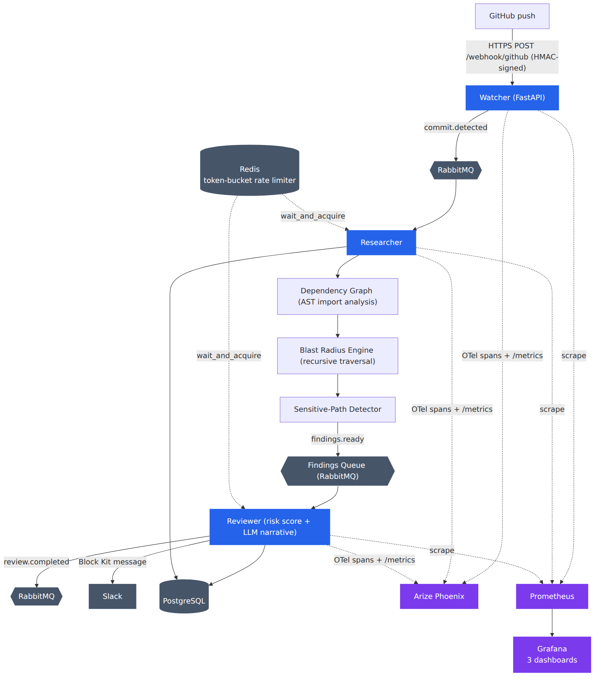

# Code Review Swarm

A team of automated helpers that checks every code change and warns you, in plain English, how risky it is before it causes trouble.

## Project Description

Software teams change their code all the time. Most commits are harmless. A few quietly break something far away from where the edit was made. Code Review Swarm looks at every commit as soon as it arrives and answers one question: **"What could this change break, and how worried should we be?"**

It does this with three small programs called **agents**. Think of it like a hospital's emergency room. A **receptionist** (the Watcher) checks people in. A **nurse** (the Researcher) runs the tests and records what's wrong. A **doctor** (the Reviewer) reads the results, assigns an urgency level and writes a short explanation. Nobody walks a patient's file to the next person by hand. Files go into a shared tray, so if one person steps away, nothing gets lost.

The final result is a **risk report**. It lists which files changed and which other parts of the code depend on them. It flags whether the change touches sensitive areas such as logins or payments, and it gives a risk score from low to critical. It also includes a short written explanation. The report is saved to a database and posted to **Slack** (a team chat app).

One key design rule: **the AI explains the score but never decides it.** The score comes from fixed, predictable rules. An AI language model only puts that score into words. The same commit always gets the same score.

**How to read this diagram**

1. **GitHub push:** a developer saves a change to GitHub (the website where the code lives), and GitHub sends a signed notification to our system.
2. **Watcher:** checks the notification's signature to make sure it really came from GitHub, then posts a "new commit detected" message.
3. **RabbitMQ:** a message queue (a durable "in-tray" between agents) holds that message until the next agent is ready for it.
4. **Researcher:** picks up the message and downloads a copy of the code.
5. **Dependency Graph:** the Researcher maps which files rely on which other files, like a family tree for the code.
6. **Blast Radius Engine:** starting from the changed files, it follows that map outward to find everything that could be affected.
7. **Sensitive-Path Detector:** checks whether any changed file sits in a high-stakes folder, such as authentication, payments, infrastructure or database migrations.
8. **Findings Queue:** the Researcher drops its findings into a second in-tray.
9. **Reviewer:** turns the findings into a risk score and asks an AI model to explain that score in plain English.
10. **PostgreSQL, Slack and RabbitMQ (bottom left):** the Reviewer saves the report to the database, posts it to Slack, and announces "review completed".
11. **Redis (dotted lines, top left):** a shared counter that limits how often the agents can call the AI provider, so we don't exceed usage limits.
12. **Arize Phoenix, Prometheus and Grafana (dotted lines, bottom right):** monitoring tools. They record each commit's journey and the system's health, and Grafana shows this on dashboards.

## Why This Project Exists

**The problem.** In a growing codebase, a small edit in one file can break features in many others. A developer who changes a shared helper for saving data may not realise that login, payments and checkout all depend on it. Human reviewers usually look at the lines that changed. They often can't see how far the effects spread.

This matters most for teams handling sensitive things such as money or user accounts. A missed side effect there can mean failed payments, security gaps or a lost customer's trust.

**An example.** Imagine a small online shop. A developer tidies up the code that confirms payments, changing three files. On their own the edits look small and safe. But those three files are used by the checkout page, the shopping cart, refunds, the login page and invoicing. None of the edits came with new tests.

**How this project helps.** Within seconds of that commit, Code Review Swarm:

- maps out **every part of the shop that depends on the changed files**,
- notices that **all three files sit in the "payments" and "auth" (login) areas**,
- notices that **no tests were changed** alongside the code,
- marks the commit **high risk, needs review**, and posts a plain-English explanation to the team's Slack.

The reviewer now knows where to look before the change goes live, not after a customer complains.

## Thought Process & Approach

We describe the steps **in the order the system works**, from a commit arriving to a report being posted. We **built** the project in six phases, one layer at a time. First came reliable messaging. Then came code analysis, then the AI layer, then fault tolerance, then monitoring, and finally packaging. Each phase built on what the previous one had already proven, without redesigning it.

### Step 1: Split the work across three independent agents
- **What it does:** Each agent does exactly one job and only talks to the others by leaving messages in a shared queue.
- **Why we did it this way:** If one agent crashes or slows down, the others carry on. Messages wait safely in the queue until the agent recovers. Each agent can also be run as several copies when there's more work.
- **What we considered instead:** One single program that does everything in sequence. That is simpler, but one failure would stop the whole pipeline and lose work in progress.
- **Trade-off:** We gained resilience and the ability to scale. We gave up simplicity, because there are more moving parts to set up and monitor.

### Step 2: Receive and verify the commit (Watcher)
- **What it does:** It receives GitHub's notification, confirms it is genuine, ignores branches we don't watch, and posts one message per commit.
- **Why we did it this way:** Checking the signature (a secret-based stamp only GitHub can produce) stops anyone from feeding fake commits into the system. Doing this up front keeps the other agents simple.
- **Trade-off:** We gained security at the front door. The cost is a shared secret that has to be configured in both GitHub and our system.

### Step 3: Map how the code fits together (Dependency Graph)
- **What it does:** It reads every Python file and records which files import (use) which other files, building a map of the whole codebase.
- **Why we did it this way:** We read the code's actual structure, using Python's own built-in code parser. We didn't guess from file names or ask an AI, so the map is accurate and repeatable. It is stored in the database, so it builds up over time.
- **What we considered instead:** Asking an AI model which files are related. That would be slower, cost money on every commit, and could give different answers each time.
- **Trade-off:** We gained accuracy and consistency. We gave up language coverage, because today it only understands Python code.

### Step 4: Measure how far a change spreads (Blast Radius)
- **What it does:** It starts at the changed files and walks the map backwards, asking "who uses this?" again and again. That gives the full list of affected parts and how many steps away they are.
- **Why we did it this way:** This is plain counting on a map, with no guesswork, so the same change always produces the same result and anyone can check it. A depth limit stops it from running forever on very tangled code.
- **Trade-off:** We gained a trustworthy, auditable number. The limitation is that it only sees links the code declares directly. Indirect links, such as two features sharing a database table, are invisible to it.

### Step 5: Flag high-stakes areas (Sensitive-Path Detection)
- **What it does:** It checks every changed file against a list of sensitive folders (by default: authentication, payments, infrastructure and database migrations).
- **Why we did it this way:** A one-line change to login code can be dangerous even if nothing else depends on it. This check is deliberately separate from the blast radius, so small-but-sensitive changes can't slip through.
- **Trade-off:** It is simple and easy to configure. But it relies on teams keeping sensitive code in clearly named folders.

### Step 6: Write a short summary of the change (AI summary)
- **What it does:** A small, low-cost AI model writes a two- or three-sentence summary of what the commit does.
- **Why we did it this way:** Humans read sentences faster than lists of files. If the AI is unavailable, the summary is simply left empty and the pipeline carries on.
- **Trade-off:** We gained readability. The cost is a small per-commit AI fee, plus a dependency on an outside provider. We designed that dependency so it can never block a report.

### Step 7: Calculate the risk score (fixed rules, no AI)
- **What it does:** It adds up points from five signals: how far the change spreads, how many parts are affected, how many sensitive files are touched, how many files changed, and whether tests were changed nearby. The total maps to **low, moderate, high or critical**, and to a status of **passed, needs review or failed**.
- **Why we did it this way:** A risk score people act on has to be predictable and explainable. The same input always gives the same score, and every point can be traced to a reason.
- **What we considered instead:** Letting an AI model judge the risk. We rejected this because AI answers can vary between runs and can't easily be audited.
- **Trade-off:** We gained consistency and trust. We gave up some nuance, because fixed rules can't "understand" a change the way an experienced reviewer can.

### Step 8: Explain the score in plain English (AI narrative)
- **What it does:** It gives the AI model the final, locked score and asks it only to explain why. If no AI is available, a ready-made template writes the explanation instead.
- **Why we did it this way:** It combines the reliability of fixed rules with the readability of AI writing. The model is told never to state a different score, so the rules always win.
- **Trade-off:** We gained clear explanations without handing the decision to AI. The template fallback reads less naturally than the AI version.

### Step 9: Save and share the report
- **What it does:** It saves the report to the database, posts a colour-coded message to Slack, and announces that the review is complete.
- **Why we did it this way:** The database keeps a permanent history. Slack puts the result where the team already works.
- **Trade-off:** We gained visibility. For now Slack is the only chat tool supported.

### Step 10: Make every step survive failures (reliability layer)
- **What it does:** Every agent follows the same safety rules:
  - **Retry with growing waits.** After a temporary failure, it tries again after 5 seconds, then 30 seconds, then 5 minutes.
  - **Set aside broken messages.** Messages that can never succeed go to a separate "dead-letter" holding area, so they don't block everything else. A tool lets us replay them once the cause is fixed.
  - **Never do work twice.** Each message is "claimed" before work starts, so a message delivered twice doesn't produce two reports. If an agent crashes mid-task, the claim expires and the work is safely picked up again.
  - **Stay within AI usage limits.** A shared rate limiter controls how often all copies of an agent call the AI provider.
  - **Stop calling a broken AI provider.** A "circuit breaker" (like the fuse in a house) stops calling a failing provider for a while instead of piling up errors.
- **Why we did it this way:** Our message queue can occasionally deliver a message more than once, and outside services do fail. We built for that from the start rather than hoping it wouldn't happen. We tested these rules with deliberate crash and failure scenarios, not only routine checks.
- **Trade-off:** We gained a system that doesn't lose or duplicate reports. We gave up simplicity, because this layer is a large share of the code.

### Step 11: Make every step visible (monitoring)
- **What it does:** Each commit gets one tracking ID that follows it through all three agents. Every log entry and timing measurement is tagged with that ID, and dashboards show the system's health.
- **Why we did it this way:** When something goes wrong in a system with several moving parts, you need to see exactly where. One ID lets us follow a single commit's journey from GitHub to Slack.
- **Trade-off:** We gained fast troubleshooting. We gave up some setup simplicity, because three extra monitoring tools have to run alongside the system.

## Tech Stack

| Tool / Technology | Why we used it |
|---|---|
| **Python 3.11+** | The whole system is written in it, and its built-in code reader lets us analyse Python projects accurately |
| **FastAPI** | Powers the Watcher, which receives notifications from GitHub |
| **GitHub webhooks** | How the system learns about new commits the moment they happen |
| **RabbitMQ** | Lets the three agents pass work to each other without losing it if one is down |
| **PostgreSQL** | Stores the code map, the reports and the "already processed" claims |
| **Redis** | Keeps a shared count of AI requests so all copies of an agent respect usage limits |
| **Pydantic** | Makes sure every message between agents follows an agreed, versioned format |
| **Anthropic, OpenAI or Ollama** (choose one) | Writes the short summaries and plain-English explanations. The system works with any of the three, or with none |
| **Slack** | Where the finished risk reports are posted |
| **OpenTelemetry** | Tags every step of a commit's journey with one shared tracking ID |
| **Arize Phoenix** | Shows a timeline of each commit's journey through all three agents |
| **Prometheus** | Records throughput, retries, failures, AI cost and timings |
| **Grafana** | Three ready-made dashboards: system overview, AI usage and code analysis |
| **Docker / Docker Compose** | Lets the whole system, including all the supporting services, start with one command |
| **GitHub Actions** | Runs the automated tests and builds whenever code changes |
| **pytest, ruff, black, mypy** | Check that the code works and stays readable |

## Limitations

- **It only understands Python code.** The code map is built by reading Python files. *In practice:* changes in other languages (such as JavaScript or Java) won't get a meaningful blast radius.
- **The "were tests changed?" check is a guess based on file names.** The Reviewer doesn't measure real test coverage. It looks for test files near the change. *In practice:* a well-tested change might still lose points, or a badly tested one might pass this check.
- **It only sees direct code links.** The blast radius follows import links between files. *In practice:* indirect connections, such as two features sharing a database table or calling each other over the network, aren't counted.
- **It has only been load-tested with one copy of each agent.** In our 100-commit test, every commit was processed, nothing failed, and the system handled about 7.85 commits per second. But commits were handled strictly one at a time. *In practice:* during a burst, later commits wait in line (around 12 seconds for the slowest), and running several copies is designed for but not yet proven.
- **It re-reads the whole codebase on every commit.** *In practice:* this is fine for small and medium projects but would slow down noticeably on very large ones.
- **The "fuse" for a failing AI provider works per copy, not system-wide.** *In practice:* when several copies run, each one has to discover on its own that the provider is down.
- **Database updates are applied by hand.** There's no automatic tool for upgrading the database structure. *In practice:* upgrading an existing installation needs careful manual steps.
- **There are no alerts, only dashboards.** *In practice:* someone has to look at the dashboards to notice a problem. Nobody gets paged automatically.
- **It runs on a single machine.** The setup files are for one server. *In practice:* it isn't yet ready to spread across a cluster of machines.
- **Slack links point to the commit, not a side-by-side comparison.** *In practice:* reviewers see the commit itself and must open GitHub's comparison view on their own.

## Future Improvements

### Short term
- **Share the AI "fuse" across all copies,** using the same shared-scratchpad approach as the rate limiter. *Benefit:* when a provider goes down, every copy stops calling it at once, avoiding wasted requests.
- **Add automatic alerts** on top of the existing measurements, for example when failures spike or the database goes offline. *Benefit:* problems reach a person without anyone needing to watch a dashboard.
- **Add an automatic database upgrade tool.** *Benefit:* safer, repeatable upgrades for existing installations.

### Long term
- **Only re-read the files that changed.** *Benefit:* fast analysis even on very large codebases.
- **Sort git errors more precisely,** separating permanent failures from temporary ones. *Benefit:* hopeless tasks are set aside immediately instead of being retried three times first.
- **Run across multiple machines** with a cluster manager such as Kubernetes (a system for running software across many servers). *Benefit:* higher capacity and no single machine as a point of failure.
- **Add a central collector for monitoring data.** *Benefit:* easier to send the same data to more than one monitoring tool.
- **Support more programming languages.** *Benefit:* useful for teams that work in more than one language.
- **Measure real test coverage** instead of guessing from file names. *Benefit:* more accurate risk scores.
